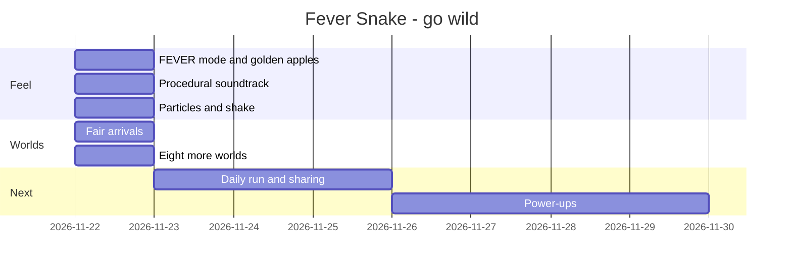

# Go wild (2026-11-22, evening)

Extends `overview.md` and `worlds-expansion.md`.

## Scope

- FEVER mode (combo of 3 apples → x3 points, rainbow, faster music) and rare
  golden apples.
- Procedural per-world chiptune soundtrack.
- Game feel: particles, score popups, screen shake.
- Fair arrivals between worlds (long free runway + slow first ticks).
- Worlds now 21: plus Möbius Strip, Deep Space, Vertigo, Checkmate,
  Aquarium, Klein Bottle, Black Hole, Mirror Twins.

## Next ideas

- Daily seeded run with shareable score (Web Share API).
- Power-up variety (ghost through walls, slow motion, shrink).
- WebGL fallback: skip 3D worlds when WebGL is unavailable.
- Accessibility: reduced-motion toggle that also disables shake and rainbow.

