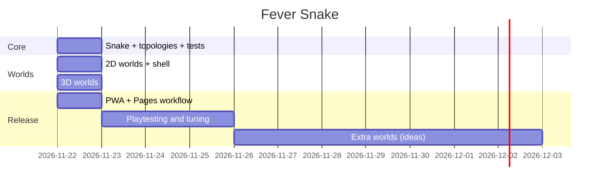

# Fever Snake — plan (2026-11-22)

## Goal

A browser snake game, published on GitHub Pages and playable offline, whose
world changes every 5 apples: different visuals, topologies (flat grid, torus,
cube surface) and control schemes.

## Scope

- Static site, no build step; three.js vendored for the 3D worlds.
- Eight worlds: Neon Classic, Retro 95, The Cube, Pocket LCD, Tube Maze,
  Terminal, Labyrinth (first person), Notebook. Loop with a speed bonus.
- Keyboard and swipe input, WebAudio sound effects, best score in localStorage.
- PWA: manifest + service worker precache; GitHub Actions deploy to Pages.

## Milestones

1. Core: topology-agnostic snake, grid and cube topologies, unit tests.
2. 2D worlds and game shell (HUD, overlays, warp transition).
3. 3D worlds (cube, tube, first person).
4. PWA + Pages deployment.
5. Later ideas: more worlds (sphere, isometric, mirror controls), music,
   touch d-pad option, online leaderboard.

## Risks

- WebGL unavailable on some devices → 3D worlds fail. Mitigation idea: skip
  3D worlds when WebGL is missing (not implemented yet).
- Relative controls in 3D can disorient; camera-relative mapping chosen.

