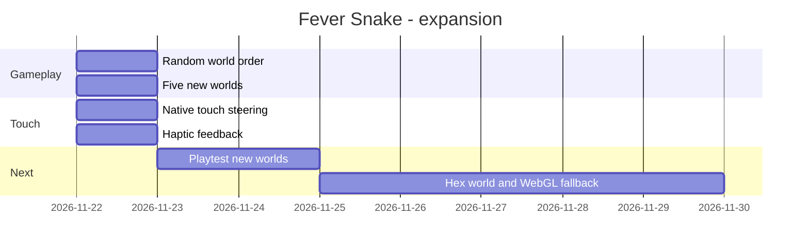

# World expansion and touch polish (2026-11-22, later the same day)

Extends `overview.md` after playtesting feedback.

## Scope

- Five new worlds: Spreadsheet, Portals (new portal topology), Tiny Planet
  (3D, cubed sphere), Isometric Garden (2.5D), Lights Out. Total: 13.
- Random world order per run and per loop; two 3D worlds never adjacent
  (one shared WebGL canvas during the live portal transition).
- Touch: native touch events for continuous steering with the finger down,
  short vibration on each detected turn.
- Service worker switched to network-first so deploys reach players at once.

## Next ideas

- Hex-grid world (6 directions), sphere-with-poles world, music per world.
- WebGL fallback: skip 3D worlds when WebGL is unavailable.

